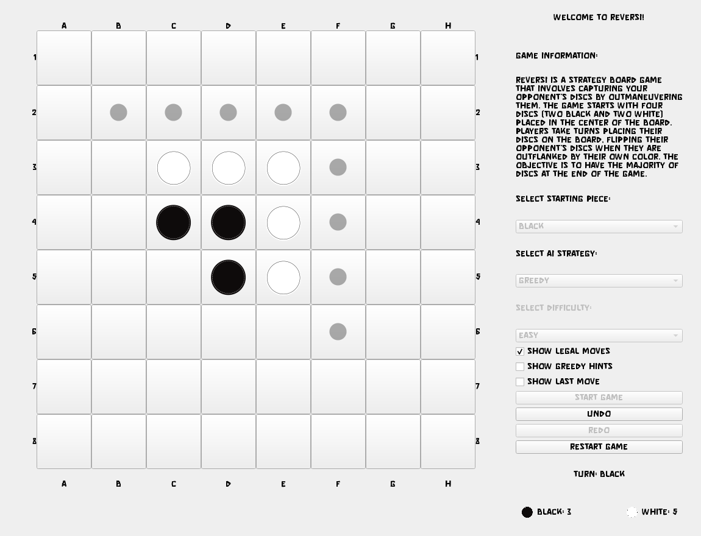

<h1 align="center">Reversi</h1>
<p align="center">Reversi against an alpha-beta minimax AI, with a PyQt5 board.</p>
<p align="center">
  <a href="#features">Features</a> ·
  <a href="#how-the-ai-works">How the AI works</a> ·
  <a href="#run">Run</a> ·
  <a href="#ai-vs-ai-simulations">Simulations</a>
</p>
<p align="center">
  <a href="https://github.com/elsisiem/reversi/actions/workflows/ci.yml"></a>
  
  
  
</p>
<p align="center"></p>

## Features

- Play Black or White against one of three opponents: Greedy (most discs flipped), Minimax (fixed depth), or Minimax with iterative deepening.
- Easy, Medium and Hard settings that change the search depth and the time budget.
- Legal moves marked on the board, an optional hint showing how many discs each move flips, and an optional highlight on the last move.
- Undo, redo, restart, and a live disc count.
- The AI searches in a worker thread (`QThread`), so the window stays responsive while it thinks.

## How the AI works

Code: `ai.py` for the search and evaluation, `game_logic.py` for the rules.

**Search**

- Minimax with alpha-beta pruning (`minimax`). Root moves are ordered first: corners score highest, then moves that leave a disc on the top or bottom edge row, minus the opponent's mobility after the move (`score_move_for_ordering`).
- A transposition table keyed by a 64-bit Zobrist hash, updated incrementally in `make_move`. Each entry stores the depth it was searched to and whether its score is exact or a bound from a cutoff. An entry is reused only if it was searched at least as deep as the current node. The key also includes the side to move, because the hash does not.
- Iterative deepening (`find_best_move`) searches depth 1, 2, 3 and so on up to a maximum. The deepest completed iteration decides the move. With a time limit, the unfinished iteration is discarded.
- Minimax at a fixed depth is `find_best_move_original`.

**Evaluation**

Leaves are scored by `evaluate_board`: a weighted sum of terms, each computed as the searching side minus the opponent. The weights depend on the game phase, taken from the number of empty squares: early (more than 40), mid (21 to 40), end (20 or fewer).

| Term | What it measures | Early | Mid | End |
| --- | --- | --- | --- | --- |
| Mobility | Number of legal moves | 0.5 | 0.3 | 0.1 |
| Potential mobility | Empty squares next to an opponent disc | 0.2 | 0.1 | 0.1 |
| Parity | Even or odd number of empty squares (+1 or -1) | 0.1 | 0.2 | 0.5 |
| Stability | Discs for which `can_be_flipped` is false | 0.1 | 0.3 | 0.5 |
| Corners | Corners owned | 3 | 4 | 5 |
| Edges | Stable-looking discs on the edge rows and columns | 2 | 2 | 3 |
| Disc difference | Discs on the board | 0.1 | 0.5 | 1 |

Mobility and potential mobility dominate the opening, corners carry the most weight throughout, and parity, stability and disc count take over near the end.

**Known limits**

- It is pure Python. Fixed-depth Minimax is comfortable at depth 5 to 6; deeper iterative searches are bounded by the time limit instead.
- A node where the side to move has no legal move is scored as a leaf. Passes are not searched.
- Stability is a cheap approximation, not a full stable-disc analysis.
- `opening_book`, `count_frontier_discs` and `calculate_corner_adjacency` are defined in `ai.py` but not used by the evaluation or the search.

## Run

Python 3.11 is the tested version.

```bash
pip install -r requirements.txt
python main.py
```

Run it from the repository root: the fonts and disc images load from relative paths.

Difficulty settings in the GUI:

| Strategy | Easy | Medium | Hard |
| --- | --- | --- | --- |
| Minimax (depth) | 5 | 6 | 6 |
| Iterative deepening (max depth, time limit) | 8, 2 s | 11, 5 s | 15, 10 s |

## AI vs AI simulations

Each script plays 10 games when you run it and prints the result. They need only numpy.

| Script | Matchup |
| --- | --- |
| `simulator_random.py` | Minimax depth 3 vs random moves |
| `simulator_greedy.py` | Minimax depth 6 vs greedy |
| `simulator_minimax.py` | Minimax depth 3 vs iterative deepening to depth 5 |
| `simulator_iterative.py` | Iterative deepening to depth 3 vs to depth 7 (slow: no time limit) |

```bash
python simulator_random.py
```

Minimax wins 10 of 10 against random moves and against greedy in a local run. Minimax and greedy are both deterministic, so the ten greedy games are identical.

## Tests

```bash
python -m unittest minmax_test
```

Five tests, numpy only. They check that a search never modifies the board it is given, that alpha-beta with the transposition table returns the same value as an unpruned search (with the table kept warm across depths), that a shallow table entry is not reused for a deeper search, and that iterative deepening respects its time limit. CI runs them on every push.

## Credits

The fonts in `Fonts/` are third-party and belong to their authors: `Bionix.otf`, `NIKEA.otf`, `Quantum.otf`, `RockBoulder.ttf`, `play.ttf`, `space.otf`. This repository does not grant any license to them, so check each font's terms before you redistribute them. `gui.py` loads `RockBoulder.ttf` and `space.otf`; the other four are bundled but not loaded.

## License

MIT. See [LICENSE](LICENSE). The license covers the code, not the fonts.
